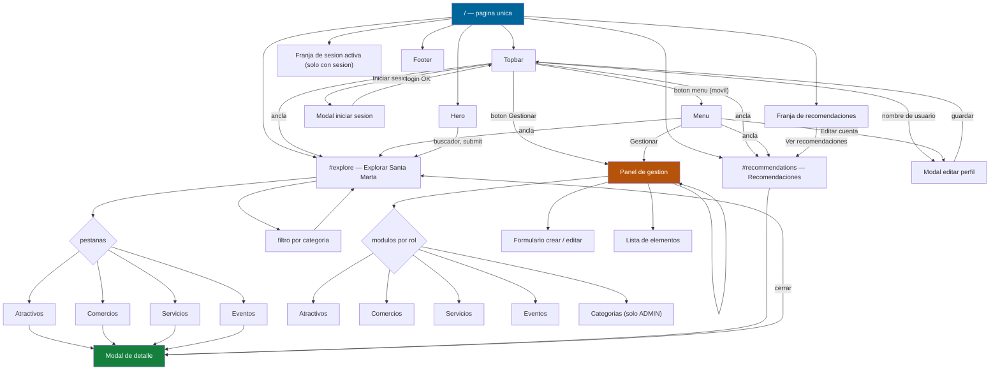
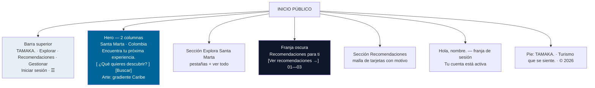
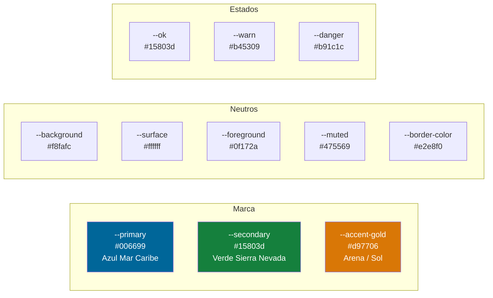

# Tamaka — Wireframes y navegación

Documento generado a partir de la aplicación desplegada en `https://proto.taminaka.com`
y del código fuente (`src/app/page.tsx`, `src/app/globals.css`).

**Origen:** el repositorio no incluye wireframes. Estos se reconstruyeron desde la
implementación real, que es la referencia vigente del diseño.

## Arquitectura de navegación

La aplicación es de **una sola ruta** (`/`). No hay enrutado: la navegación se resuelve
con estados de React (`active`, `selected`, `authOpen`, `accountOpen`, `managementOpen`)
y anclas al documento (`#explore`, `#recommendations`).



## Permisos de navegación por rol

| Elemento de navegación | TURISTA | OPERADOR | GESTOR | ADMIN |
|---|---|---|---|---|
| Explorar (catálogo) | Sí | Sí | Sí | Sí |
| Recomendaciones | Sí (con sesión) | Sí | Sí | Sí |
| Iniciar sesión | Sí | Sí | Sí | Sí |
| **Gestionar** | **No** | Sí | Sí | Sí |
| Módulos del panel | — | Comercios, Servicios, Eventos | Atractivos, Eventos | Todos |
| Categorías | — | No | No | Sí |

> **Nota crítica:** la navegación ofrece esos módulos, pero la API de producción
> solo responde `200` a `ADMIN`. Ver `INFORME-PRUEBAS.md`.

---

## Vista 1 — Inicio público



### Barra superior con sesión

```
┌──────────────────────────────────────────────────────────────────────┐
│  TAMAKA▪          Explorar  Recomendaciones  Gestionar              │
│                                                    Nombre [GESTOR]  │
│                                                    Salir      ☰     │
└──────────────────────────────────────────────────────────────────────┘
```

El **badge de rol** se inserta entre el nombre y "Salir". Con varios roles se
muestra el de mayor jerarquía (ADMIN > GESTOR > OPERADOR > TURISTA).

| Rol | Badge | Color |
|---|---|---|
| ADMIN | `ADMIN` | índigo `#e0e7ff` / `#3730a3` |
| GESTOR | `GESTOR` | ámbar `#fef3c7` / `#92400e` |
| OPERADOR | `OPERADOR` | cielo `#e0f2fe` / `#075985` |
| TURISTA | `TURISTA` | esmeralda `#d1fae5` / `#065f46` |

---

## Vista 2 — Catálogo con pestañas

```
┌──────────────────────────────────────────────────────────────────────┐
│  OFERTA TURÍSTICA                          Ver todo →               │
│  Explora Santa Marta                                                 │
│  ┌────────────────────────────────────────────────────────────────┐  │
│  │ Atractivos │ Comercios │ Servicios │ Eventos        ← pestañas │  │
│  └────────────────────────────────────────────────────────────────┘  │
│  [ Todas las categorías ▾ ]  [ Aplicar filtros ]   ← filtros        │
│                                                                      │
│  ┌────────────┐ ┌────────────┐ ┌────────────┐                        │
│  │   imagen   │ │   imagen   │ │   imagen   │   ← 3 columnas        │
│  │   [LOW]    │ │  [MEDIUM]  │ │   [LOW]    │   ← badge ocupación   │
│  ├────────────┤ ├────────────┤ ├────────────┤                        │
│  │NATURALEZA  │ │PLAYAS      │ │PATRIMONIO  │   ← categoría        │
│  │ Tayrona    │ │ Rodadero   │ │ Quinta     │   ← nombre            │
│  │ descripción│ │ descripción│ │ descripción│   ← descripción      │
│  │ Ver detalle│ │ Ver detalle│ │ Ver detalle│                        │
│  └────────────┘ └────────────┘ └────────────┘                        │
└──────────────────────────────────────────────────────────────────────┘
```

**Estados:** con resultados · vacío (`No encontramos resultados para esta
búsqueda.`) · error (`.notice.error` sobre la rejilla).

**Responsive:** 3 columnas → 2 bajo 800px → 1 bajo 520px.

---

## Vista 3 — Modal de detalle

```
        ┌────────────────────────────────────────────┐
        │  ▓▓▓ fondo oscurecido ▓▓▓                 │
        │   ┌──────────────────────────────────┐   × │
        │   │      [ imagen o inicial ]        │     │
        │   ├──────────────────────────────────┤     │
        │   │ NATURALEZA · AVENTURA            │     │
        │   │ Tayrona                          │     │
        │   │ Uno de los destinos más          │     │
        │   │ representativos del Caribe...   │     │
        │   │ ⌖ Entrada El Zaino               │     │
        │   │ Ocupación actual: LOW            │     │
        │   │ [ Cerrar detalle ]               │     │
        │   └──────────────────────────────────┘     │
        └────────────────────────────────────────────┘
```

> **Hallazgo documentado:** el bloque de imagen del modal muestra la inicial del
> nombre en lugar de `offer.images[0]`. Es una limitación conocida, no un error de
> este refactor. Ver `INFORME-PRUEBAS.md`.

---

## Vista 4 — Autenticación y perfil

### Modal de inicio de sesión

```
   ┌──────────────────────────┐
   │ Tu cuenta            ×  │
   │ Iniciar sesión           │
   │ Correo   [____________]  │
   │ Contraseña[____________]  │
   │ [ Entrar ]               │
   └──────────────────────────┘
```

### Modal de editar perfil

```
   ┌──────────────────────────────┐
   │ Tu cuenta                ×  │
   │ Editar perfil           [GESTOR]
   │  ( P ) [Cambiar foto]        │
   │  Nombre completo [______]    │
   │  Correo         [______] ⃠   │  ← deshabilitado
   │  Teléfono        [______]    │
   │  Dirección       [______]    │
   │  [ Guardar cambios ]          │
   │  ─────────────────────────    │
   │  Modo activo: OPERADOR       │
   │  [ Cambiar a modo turista ]   │
   └──────────────────────────────┘
```

Si el usuario **no** tiene rol OPERADOR, el bloque inferior se sustituye por el
formulario «Habilitar mi operación» (negocio, NIT, dirección, teléfono).

---

## Vista 5 — Panel de gestión

```
┌───────────────────────────────────────────────────────────────────────┐
│ Panel de gestión                                                  ×    │
│ Administrar Tamaka          [ADMIN] [TURISTA]     ← badges de rol     │
│ ┌───────────────────────────────────────────────────────────────────┐ │
│ │ [ Atractivos ▾ ] [ Nuevo ]                                        │ │
│ └───────────────────────────────────────────────────────────────────┘ │
│ ┌─────────────────────────────┐ ┌─────────────────────────────────┐ │
│ │ ELEMENTOS                   │ │ Crear Atractivos                │ │
│ │ ─────────────────────────── │ │ Nombre       [____________]     │ │
│ │ Tayrona              ACTIVO  │ │ Descripción  [____________]     │ │
│ │            [Editar] [Desact]│ │ Dirección    [____________]     │ │
│ │ ─────────────────────────── │ │ Capacidad    [______]           │ │
│ │ Rodadero             ACTIVO  │ │ Categorías                      │ │
│ │            [Editar] [Desact]│ │  [Naturaleza] [Playas] ...      │ │
│ │                             │ │ Imágenes [Subir]                 │ │
│ │                             │ │ [ Crear ]                        │ │
│ └─────────────────────────────┘ └─────────────────────────────────┘ │
│ ─────────────────────────────────────────────────────────────────── │
│ Categorías                        ← solo ADMIN                        │
│ [ Nombre ][ Descripción ] [ Crear categoría ]                        │
│ [Playas ×] [Naturaleza ×] [Aventura ×]                              │
└───────────────────────────────────────────────────────────────────────┘
```

**Módulos por rol:**

| Rol | Módulos disponibles |
|---|---|
| ADMIN | Atractivos, Eventos, Comercios, Servicios, Eventos de comercio, Categorías |
| GESTOR | Atractivos, Eventos |
| OPERADOR | Comercios, Servicios, Eventos de comercio |

**Responsive:** el panel es de 2 columnas; bajo 760px pasa a 1 columna y la barra
de herramientas se apila.

---

## Paleta aplicada



Todas las combinaciones de texto verificadas contra **WCAG 2.1 AA** (4.5:1).
Resultados en `test-contraste.mjs`.
